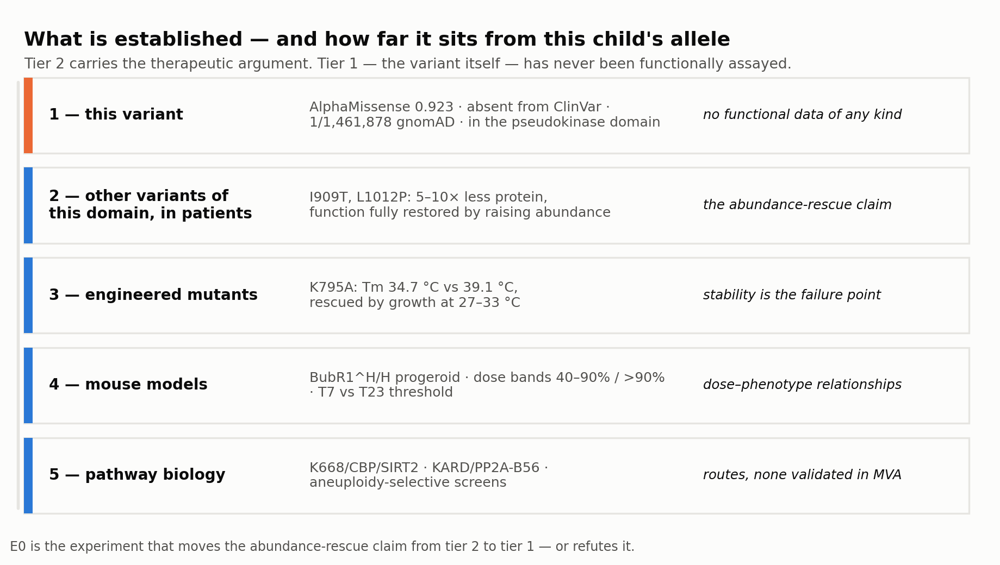
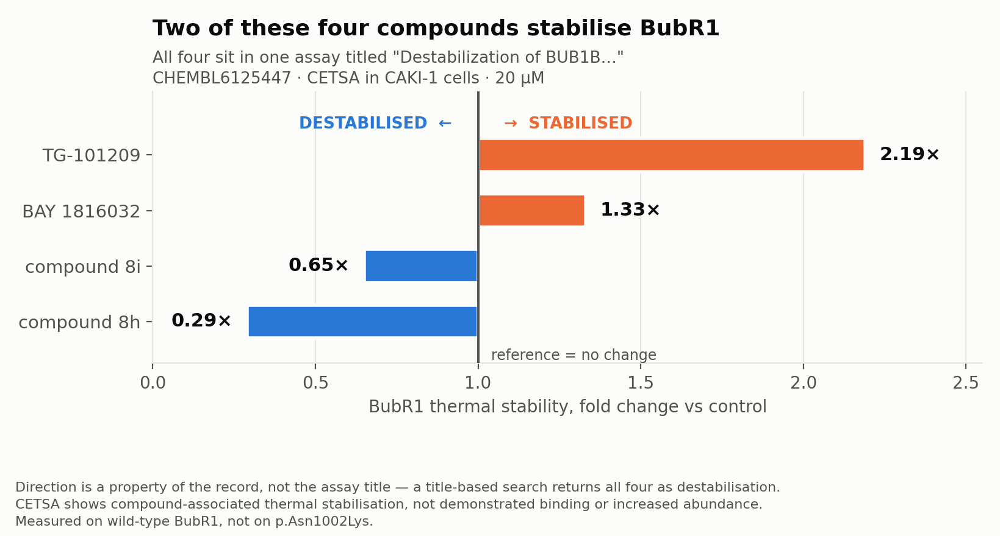
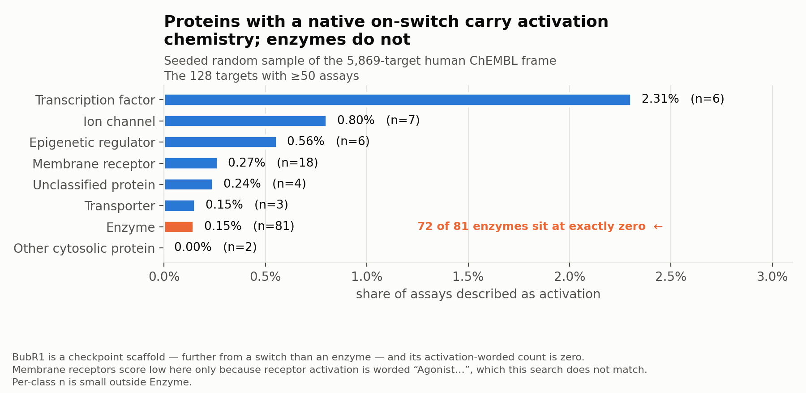
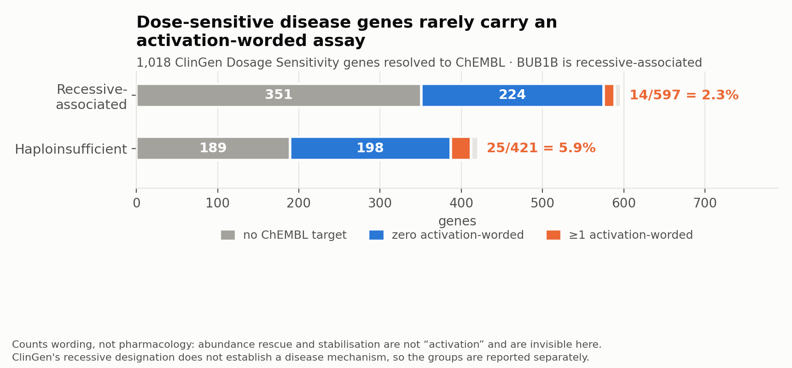
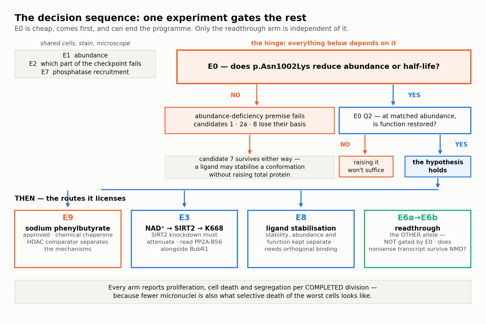

# Track 2 — Mechanism and Drug Repurposing

**Rare Disease, Real Kid: MVA Hackathon 2026** · proband `PROBAND01` · Daniel Hwang, building on team `texdata`'s earlier submission · 24 October 2026
Pitch: [`track2-video-script.md`](track2-video-script.md) · code: this repository, `mva/track2/`

> **Hypotheses for follow-up, not evidence that a medicine works.** Nothing here has been tested in anyone with MVA1, and nothing substitutes for this child's oncology team.

> **The causal genotype is identified.** Team `texdata`'s Track 1 submission, which this work builds on, returned **rank points 100.0 and F-max 1.000, full match at rank 1** against the clinically confirmed answer key — *two separate fields rather than a composite score, and the organisers state that perfect Track 1 results are expected.* So it establishes **which variants cause the disease** and nothing further: not their phase experimentally (trans is inferred from the diagnosis), not the function of either allele, and not any rescue mechanism below.

> **Thesis.** This genotype disrupts **two** biologies and they have different answers. **The lesion** — too little BubR1 — has no approved drug: the generic-chaperone shortcut was taken into randomised trials in the paradigm misfolding disease and failed, while the route that *worked* there was a purpose-built stabiliser, and §4.1 names two starting compounds. **The consequence** — the proteostatic and mitochondrial cost of constitutional aneuploidy — does have one, with 2026 human-cell evidence. Candidates are chosen by **record-level assay evidence** and separated by **functional tests** that distinguish restored accurate division from raised abundance, suppressed proliferation, or selective loss of the worst cells.

**Five contributions.**

1. **Published rescue of *other* *BUB1B* variants supports a testable stability hypothesis for `p.Asn1002Lys`.** In MVA patient alleles of the same domain class, restoring abundance to wild-type levels **fully restored checkpoint response** in human cells; the defect is a destabilised fold cleared by the proteasome, and cooling alone rescues a pseudokinase-domain mutant's level *and* its checkpoint (§2). **This child's substitution has never been tested.** The first variant-specific evidence we could produce is structural, and it **cuts both ways**: the microenvironment suits a destabilising substitution, but the variant sits 22–35 Å from the pocket whose thermal precedent the argument leans on (§2.0). **E0** remains the hinge.
2. **Chemical matter exists that moves BubR1 the right way — found by reading records, not titles.** Two compounds raise BubR1's thermal stability in living cells, inside an assay titled *"Destabilization of BUB1B…"* (§4.1); that is candidate 7. We then asked whether the step generalises as a **rule**, over 47,000 records with a held-out set. It does not: every apparent decision change adjudicates to a correct inverse relation or a value-convention artifact, **none genuine** — six assays read by hand, the rest by a fixed rule (§4.2). Read the records — do not automate it.
3. **An approved drug addresses the *consequence*, and the field already ran the experiment on the shortcut to the lesion.** Constitutional aneuploidy imposes a **chronic proteostatic burden**: human trisomic cells carry saturated, failing autophagy–mitophagy, and **metformin restores flux and lysosomal competence** ([Mollo 2026](https://pubmed.ncbi.nlm.nih.gov/42900242/)); a *Drosophila* MVA model independently implicates proteostasis and mitochondrial failure ([González-Blanco 2026](https://pubmed.ncbi.nlm.nih.gov/41820377/)). That is candidate 10 — and it **reverses** candidate 4, since hydroxychloroquine would inhibit the autophagy these cells cannot already sustain. Meanwhile the shortcut to the lesion itself, **4-PBA**, went into randomised trials as a CFTR corrector and Cochrane found **insufficient evidence of clinically important effect**, while purpose-built correctors succeeded ([Smith 2018](https://pubmed.ncbi.nlm.nih.gov/30070364/)). **Borrow for the consequence; build for the lesion.**
4. **The scarcity is general, and the exceptions show what closes it.** Across **1,018 ClinGen-curated genes**, **53% have no ChEMBL target at all**, and of the 421 haploinsufficient genes only **5.9%** carry an activation-worded assay — 11.1% of those ever assayed (§4.3). The genes that do have deliberate programmes behind them: glucokinase activators, p53 reactivators, channel openers.
5. **The genotype partitions the therapeutic space.** Each allele licenses different interventions, and this child is the one configuration where both branches are live (§9).

*Direction-aware filtering, declining checkpoint inhibitors, residual-protein reasoning, NAD⁺/SIRT2 and 4-PBA all appear in other public entries. **What does not is reading direction at the record rather than the assay title** — the step that recovered two stabilisers from an assay titled "Destabilization" (§4.1–4.2) — together with **a testable stability hypothesis for this specific allele**, **two approved drugs whose mechanisms disagree with each other**, and **experiments whose endpoint is accurate division, built to separate it from abundance, transcription, cytostasis and cytotoxic selection.***

*Not established: `p.Asn1002Lys` has never been functionally assayed; everything above is inference from its allele class, and **E0** converts or refutes it.* **Eleven experiments (E0–E10)** follow in §7. *Appendices: **A** pharmacogenomics, including the dossier's most actionable finding; **B** genomic correction; **C** corrections.*

---

## 1. The lesion

*BUB1B* encodes **BubR1**, 1050 aa ([UniProt O60566](https://rest.uniprot.org/uniprotkb/O60566)): BUB1 N-terminal domain 62–226, **pseudokinase domain 766–1050**, D882 annotated as catalytic proton acceptor.

| Allele | Consequence |
|---|---|
| **`p.Leu737Ter`** (`c.2210T>G`) | Stops after residue 736, losing **314 of 1050 residues** — the entire pseudokinase domain. PTC **746 nt upstream** of the final junction, far past the 50–55 nt rule. **NMD predicted**, and measured at the *neighbouring* allele (386X undetectable, 731X reduced two-fold, both expressed when NMD is bypassed — [Suijkerbuijk 2010](https://pubmed.ncbi.nlm.nih.gov/20516114/)). **Residual transcript and protein here are unmeasured.** |
| **`p.Asn1002Lys`** (`c.3006T>G`) | Full length, inside the pseudokinase domain. AlphaMissense **0.923**, MVP 0.852; REVEL **0.472**, which sits in ClinGen's indeterminate band (0.290–0.644) and is reported rather than averaged away. **1 allele in 1,461,878** gnomAD v4 exomes. |

**Database status of allele B.** `c.3006T>G` is **not in ClinVar**; ClinVar holds `c.3006T>**A**` — a different nucleotide encoding the same residue — as a single-submitter **VUS**. The genotype is confirmed by the answer key, not a database; the mechanistic argument rests on allele *class* (§2).

Reduced BubR1 → checkpoint leaks → missegregation → mosaic aneuploidy and tumour predisposition. `BubR1^H/H` mice are **progeroid** — growth retardation, sarcopenia, fat loss — this proband's phenotype.

## 2. Mechanism: a folding problem, and a premise already tested

**The domain is a pseudokinase, and the word is load-bearing.** BubR1 keeps the full catalytic triad (K795, D882, D911) yet phosphorylates nothing; the Gly-rich and catalytic loops are degenerate, **Ser884** replacing the canonical lysine ([Suijkerbuijk 2012](https://pubmed.ncbi.nlm.nih.gov/22698286/)), and D882N/A *"did not affect BUBR1 function"*. *Consensus with a live dissent:* [Huang 2019](https://pubmed.ncbi.nlm.nih.gov/31201382/) reports activity in **Drosophila**, the one lineage whose motifs have not degenerated.

**Those pocket residues are structural, and the fold fails without them.** K795A denatures at **34.7 °C against 39.1 °C** for wild type, and *"growth of K795A-expressing cells at 27 °C or 33 °C for 24 hr restored protein levels of the K795A mutant, and checkpoint function of these cells."* **Cooling fixes them** — the precedent candidate 7 rests on.

**The report's premise was measured, in MVA patient alleles, in human cells:**

> *"Forced overexpression of the poorly expressed substitution mutants **I909T and L1012P** to levels comparable to wild-type BUBR1 **fully restored the response to nocodazole**. This showed that these mutations do not impose significant constraints on BUBR1 function other than affecting overall BUBR1 protein abundance."* — Suijkerbuijk 2010

Both are pseudokinase-domain missense alleles, the class of `p.Asn1002Lys`. **Restore the level, restore the function.** The same paper shows why levels are low: every MVA substitution in or near the domain lost **5–10 fold** of protein while the two outside it did not; HSP90 inhibition *"severely decreased"* mutant levels while barely touching wild type, and MG132 prevented it. **A destabilised fold, cleared by the proteasome.**

**The dose–response is steep where it matters.** ~**6%** of normal BubR1 caused missegregation in most cells; ~**13%** had *"virtually no impact"*. In vivo a **40–90%** reduction gives tumour predisposition or mild ageing, **>90%** progeroid phenotypes or early lethality ([van Ree 2020](https://pubmed.ncbi.nlm.nih.gov/31738183/)). Cutting the other way, Baker's **T7 line (moderate) failed at everything** and only **T23 (~10-fold)** worked ([Baker 2013](https://pubmed.ncbi.nlm.nih.gov/23242215/)) — but that measures **extra expression above normal**, not **rescue of a deficiency**. The two bracket a real uncertainty and **nobody has measured where this genotype sits** (E1, E3). Neither answers a third question: even at T23 **cataractogenesis was not delayed**, and cataracts are a core MVA1 phenotype.

### 2.0 What is actually evidenced, and at what distance from this child

A reader should be able to tell which tier any claim sits in. **No functional experiment in the literature has tested `p.Asn1002Lys`.**

| Tier | Evidence | What it supports |
|---|---|---|
| **1 — this variant** | AlphaMissense 0.923; REVEL 0.472; absent from ClinVar; 1/1,461,878 gnomAD; **structural placement in the AlphaFold fold** (below) | Rarity, a computational prior, and a **structural** prior. Still **no functional data of any kind** |
| **2 — other pseudokinase-domain *BUB1B* variants in patients** | I909T, L1012P and others: 5–10 fold reduced protein, **function fully restored by raising abundance**; outside-domain variants unaffected; HSP90-dependent, proteasome-cleared | **The abundance-rescue hypothesis** — the strongest tier, and about the allele *class*, not this allele |
| **3 — engineered *BUB1B* mutants** | K795A: Tm 34.7 °C vs 39.1 °C; rescued by growth at 27–33 °C | That the domain's stability is the failure point, and that stabilisation can rescue it |
| **4 — mouse models** | `BubR1^H/H` progeroid; `X753/L1002P` early embryonic lethal (modelling human **L1012P**, not N1002K); dose bands 40–90% / >90%; T7 vs T23 | Dose–phenotype relationships, species discordance stated |
| **5 — pathway and general biology** | K668/CBP/SIRT2; KARD/PP2A-B56; aneuploidy-selective screens; senolytics | Mechanistic routes, none validated in MVA |

**The first variant-specific evidence is structural** (`21`). A pathogenicity score is not a stability score — AlphaMissense 0.923 says *likely pathogenic*, not *destabilised fold* — so the variant was placed in the AlphaFold model of BubR1 against a calibration set of *BUB1B* alleles whose behaviour is **measured**: destabilising `K795A`, `I909T`, `L1012P`; tolerated `Y155C`, `R550Q`.

**The calibration fails its own control, and that is the first thing to report.** `Y155C` is **tolerated at 0.7% relative solvent accessibility** — more buried than two of the three destabilising alleles — because it sits in the core of a *different* domain. Both tolerated alleles lie outside the pseudokinase domain, so **there is no tolerated control inside it**. Burial cannot call this variant, and nothing is predicted from it.

**A ΔΔG predictor then failed the same control, on the same residue** (`26`). DDGun was chosen because it is **untrained** — no parameters fitted to any experimental ΔΔG set, so it cannot have memorised these alleles and the controls mean what they appear to mean. It scores the measured-**destabilising** set at **+0.04, −4.41, −4.44** kcal/mol and the measured-**tolerated** set at **−4.71, −0.61**. The ranges overlap completely: it calls `K795A` neutral when that mutant's melting temperature is measurably **4.4 °C lower**, and calls tolerated `Y155C` the most destabilising of all six. `p.Asn1002Lys` scores **−1.70** — inside the destabilising span, and equally inside the tolerated one.

> **So no computational claim about this variant's stability is available.** Two methods that share no machinery — solvent geometry and an untrained sequence-profile ΔΔG — both fail, and **both fail on `Y155C`**: a buried, conserved residue whose substitution is nonetheless tolerated. That is a property of this protein, not a coincidence of one tool. It does not weaken **E0**; it **closes the shortcut around it**.

**What the structure does say.** `p.Asn1002Lys` sits at **14.1% RSA**, the **52nd** burial percentile of its own domain, at **pLDDT 91**, with **6 of 8 neighbours within 8 Å hydrophobic** — and Asn→Lys puts a longer, **positively charged** side chain there. A recognised destabilising configuration, and still a prior rather than a result.

One reading cuts against the report and one does not. It **is** less buried and less packed than all three measured destabilising alleles, and that stands. But **distance from the catalytic pocket does not discriminate**: `L1012P` is *measured destabilising* and sits **17.7 Å** from the nearest pocket residue, against N1002's **22.6 Å**, while *tolerated* `Y155C` is **67 Å** away. The in-domain alleles and this variant form one spatial series — K795 → 11.9 Å → I909 → 14.0 Å → L1012 → 14.1 Å → N1002 — so sitting distal to the pocket is **compatible with destabilisation, not evidence against it**.

**The central claim, at the strength it has:** `p.Asn1002Lys` has a **plausible abundance-rescue mechanism requiring variant-specific testing**. Neither that it destabilises the protein nor that raising abundance restores function is established — both remain tier-2 inferences about its class, now carrying a structural prior **consistent with them but weaker than they are**. **E0 moves them to tier 1, and this makes E0 more necessary, not less.**

### 2.1 A second defect, and a constraint it puts on candidates 1 and 2

The pseudokinase domain scaffolds **PP2A-B56** through the KARD, and PP2A-B56 opposes Aurora B to silence the checkpoint. [Gama Braga 2020](https://pubmed.ncbi.nlm.nih.gov/33207204/) shows the domain is required to promote KARD phosphorylation, with *"errors in chromosome alignment as a result of imbalance in Aurora B activity"*. The mechanism is **indirect and conformational** (PLK1 polo-box binding is intact), the effect modest (50% mitotic exit at ~35 min versus 55–65), the work **HeLa only**. So this genotype plausibly has **two** defects — quantitative from the null allele, qualitative from the missense — though *nobody has assayed `p.Asn1002Lys`, and Gama Braga tested MVA alleles for stability only.*

**BubR1 abundance is set by acetylation at K668.** **CBP** acetylates it, priming proteasomal degradation; **SIRT2** removes the mark and stabilises the protein ([North 2014](https://pubmed.ncbi.nlm.nih.gov/24825348/)). GCN5, PCAF and **p300** had no effect — only CBP. A **second, distinct** site, **K250**, is protective and written by **PCAF** ([Choi 2009](https://pubmed.ncbi.nlm.nih.gov/19407811/)). *"Activate SIRT2 → more BubR1 → better checkpoint" compresses two context-dependent axes into one, which is why **E3** reads K668 specifically and PP2A-B56 alongside.*

> **K668 is also a direct PP2A-B56 contact residue.** Residues 662–682 carry the B56 **LxxIxE** docking motif, and [Bloom & North 2021](https://pubmed.ncbi.nlm.nih.gov/33892776/) name *"K668, L669, I672 and E674"* as physically interacting with PP2A-B56. Candidates 1 and 2 both change that lysine's acetylation state to extend half-life; they may also change phosphatase binding. **Nobody has tested it** — so **E3 reads PP2A-B56, not just BubR1 levels.**

## 3. What the computational layer contributed

**The useful finding is negative, and it is now verified against public data** (`23`, re-derived from PrimeKG's released `kg.csv`; no model required). *BUB1B* carries **232 undirected edges and 0 drug edges** — an earlier draft quoted 464, which is the same count on the directed convention and was stated without naming it. **Every other MVA gene is the same**: BUB1 246, BUB3 234, CEP57 213, TRIP13 258, CDC20 250, MAD2L1 290, **all with zero drug edges**. And the contrast §6 draws is exact — the only checkpoint proteins carrying drug edges are **AURKB (10), PLK1 (12), TTK (6), CENPE (2)**, which is precisely the exclusion list. **OptimusKG was checked too and agrees** (`04`, run cold against the live graph on 24 October): *BUB1B* **1,975 edges, 0 drug edges**, and zero for every MVA gene.

Every route in §5 — raising a cofactor, inhibiting the writer of a destabilising mark, stabilising a fold, relieving proteostatic load — is a *change in protein abundance or state*, not a drug–target edge, so **none is representable in the schema these graphs use**, let alone retrievable from it. That is a statement about these graphs, not a proof that link prediction cannot infer indirect interventions. It is why candidates here were found by mechanism and then checked against the graph, not the reverse.

**The bigger graph was asked the same question and still does not answer it** (`06`, `07`). OptimusKG carries all six NAD⁺ precursors as nodes — the gap PrimeKG has — and **one is reachable from an MVA gene, but not through the mechanism in question**: nicotinamide, via BUB1B–PARP1 and BUB3–PARP1, where OptimusKG lists PARP1 as a target of nicotinamide. That edge says nothing about SIRT2 or BubR1 K668. *An earlier version of this paragraph said no precursor was reachable; the lookup it relied on matched drug names only and missed nicotinamide, which OptimusKG stores as `NIACINAMIDE`.* Also reachable, through BUB1B–SIRT2, is **cambinol**, which the literature describes as a SIRT2 inhibitor; OptimusKG labels that edge only `target`, so the graph itself does not give a direction. At NAMPT, where we expected the exception, **three of the four ligands** the graph returns — daporinad, teglarinad, teglarinad chloride — are labelled **inhibitors**, the wrong direction; GMX1777 is labelled only `target`. Across the nine proteins `07` checks, the only ligand labelled in the direction the mechanism needs is PRI-724 at CREBBP (labelled inhibitor; CREBBP writes the destabilising mark). The asymmetry §4 measures reappears wherever the graphs are asked.

TxGNN run zero-shot on the `mosaic variegated aneuploidy syndrome` node (which carries **zero drug edges**) ranked two mechanism-first hypotheses highly — hydroxychloroquine 50th and chloroquine 51st of 1,801, dasatinib 69th — after two artefacts were audited out: TxGNN ranks crystallographic fragments highest on a disease with no drug edges (ρ = −0.51 against node degree, corrected to +0.054 by scoring within its own drug list), and GraphMask's strongest raw paths run through one drug-metabolising enzyme, CYP3A4, for three of the four drugs checked. **The same checkpoint also ranks both antimalarials as contraindications for MVA, and higher**: hydroxychloroquine 16th and chloroquine 28th of 1,263 on the contraindication side (dasatinib 301st). A high rank therefore says the model associates the drug with MVA's neighbourhood; it does not say which way the drug acts (`02`).

> **Provenance, split honestly.** The **edge counts above are reproducible** from public PrimeKG by script `23`, output committed. Scripts `01`–`07` follow analyses first written by team `texdata` for this hackathon; on 24 October we **rewrote all seven as our own implementation** (shared code in `mvakg.py`, the original credited in each script) and re-ran them with the public TxGNN checkpoint, PrimeKG and OptimusKG, outputs committed. **The rankings reproduced exactly**: hydroxychloroquine 50, chloroquine 51, dasatinib 69 of 1,801; ρ = +0.054 within the drug list and −0.505 over all 7,957 drugs, both now from committed script `02`. **The path explanation changed**, because `03` now uses an exact search instead of a beam search, and a different correction. On raw gates the top path still runs through CYP3A4 for dasatinib (0.5159), hydroxychloroquine (0.5152) and paclitaxel (0.5074), the same scores as before; but chloroquine's top raw path runs through TNF (0.5523), which the earlier search did not return (it followed gate direction and pruned with a beam; ours treats edges as undirected and searches exhaustively), and its CYP3A4 path (0.5123) is second. The correction now keeps a drug–protein edge only where PrimeKG itself labels the protein the drug's *target* (not its enzyme, carrier or transporter) and drops side-effect edges, instead of excluding a 658-name list of ADME proteins and down-weighting by degree. Under it **every drug keeps paths**: dasatinib reaches BTK (0.4983), EPHA2, SRC and MAPK14; chloroquine TNF (0.5523); paclitaxel BCL2 (0.4709) and NR1I2; hydroxychloroquine only weakly, TLR9 at 0.18. The earlier finding that the corrected model has **no path** for dasatinib, hydroxychloroquine or chloroquine depended on that correction and is **withdrawn**. In both versions the top paths reach the drug's target through a related disease (neoplastic syndrome, Richter syndrome, colorectal cancer) or a shared cellular compartment, **not through anything about the checkpoint**, so they do not explain the ranking mechanistically. Script `01`'s own falsifiable prediction **failed**: the checkpoint-weakening drugs it expected on the contraindication side rank on the *indication* side instead — paclitaxel 7, vinblastine 17, eribulin 19. Running `01`–`03` needs pretrained weights and a DGL build. **No claim in §5 or §7 depends on them**, and the section's conclusion rests on the verified counts.

## 4. Chemical matter that points the right way, and how it was found

### 4.1 Two compounds stabilise BubR1 in living cells

ChEMBL target `CHEMBL4295998` carries 12 assays and 24 activity records against BUB1B. Both knowledge graphs report zero. Among those records, in a cellular thermal shift assay in CAKI-1 cells:

| Compound | Fold change | Curator annotation |
|---|---|---|
| **TG-101209** (JAK2 inhibitor) | **2.19** | *"Increase In Heat Resistance Observed"* |
| **BAY 1816032** (selective BUB1 inhibitor) | **1.33** | *"Increase In Heat Resistance Observed"* |
| two others | 0.29, 0.65 | destabilisation |

The source paper states it directly: compound 8h *"destabilizes the BUB1B protein structure, **whereas TG-101209 stabilizes it**"* ([El Hafi 2025](https://pubmed.ncbi.nlm.nih.gov/39818011/)).

**This is the first chemical matter in this dossier acting on BubR1 in the direction the genotype needs**, and candidate 7 is built on it. Four limits: CETSA shows compound-**associated** stabilisation, not demonstrated binding — most relevant for BAY 1816032, a **BUB1** inhibitor whose effect could be a network consequence; stabilising a fold is not raising abundance; the measurement is on **wild-type** BubR1 at 20 µM, never on `p.Asn1002Lys`; and of the chain **engagement → abundance → function → selectivity**, only the first step is partly in hand.

**Our own first pass discarded them.** All four records sit in one assay *titled* **"Destabilization of BUB1B…"**, so a title-reading pipeline inherits "destabilisation" for all four. Direction is a property of the **record** — `standard_type`, the sign of the value, `activity_comment` (`14`).

### 4.2 Reading direction at the record level — the transferable method

Four questions, runnable in minutes, no graph or model needed:

1. **Does chemical matter exist?** Resolve the gene to a ChEMBL target and count activities — *not* a graph lookup (§4.1: the graph says 0, ChEMBL 24).
2. **Which direction — per record, not per assay.** Count the wording for shape, then open the records.
3. **If the needed direction is absent, is there an indirect route?** Supply the substrate or cofactor, inhibit the degrader or the writer of a destabilising mark, or **stabilise the fold** — none is a drug–target edge, which is why none was retrievable in the graphs queried here.
4. **Is the problem actually abundance?** If restoring the protein's level removes the phenotype (§2), the question is *stabilisation*, not activation.

**Can that step be automated? We tested it, and the answer is no — which is the finding.** Two pipelines answered one query — *find compounds that move this target up* — over **47,000 fold-change records** in two seeded samples, one the rules were written on and one **held out with the rules frozen** (`18`). Record-level reading appeared to change the decision for **16.9%** and **24.8%** of adjudicable records, nearly all false negatives. (The first run lost exploratory pages 15–18 to ChEMBL errors and reported 14.4% on 19,773 records; the complete re-run of 24 October has all 24 pages and 23,747 records.)

**Those numbers do not survive adjudication, and that is the result worth reporting** (`19`). The 323 false-negative records come from only **109 assays**, six supplying 103 — a per-record rate counts one experimental design dozens of times, which is what the 8-point gap between samples is. One vote per assay: **59% are correct inverse relations** (*"Inhibition of class 1 histone deacetylase … assessed as increase in histone H3K9 acetylation"* — inhibiting HDAC *does* raise it), **41% are value-convention artifacts**, **none is genuine**. Only the six largest assays were read by hand; the other 103 were classified by a fixed text rule that has no "genuine" outcome, so "none is genuine" is firm for those six and a rule result for the rest. The 15 assays added by the recovered pages (49 records, among them Keap1–Nrf2 and MDM2–p53) have not been read by hand. The rule leaks through a noun shared by target and endpoint — `histone`, `nrf2`, `p53` (`15`, `16`).

**So the claim is narrower and firmer than a percentage.** Reading records changed the decision in the case that mattered, and **no text rule can be trusted to find it**: one permissive enough to catch BubR1 readmits dozens of correct inverse relations and buries it. *For a gene that matters, open the records — and do not delegate that to a classifier, including ours.*

### 4.3 The context: a catalogue written to turn things off

Across ChEMBL, descriptions beginning **"Inhibition of…"** outnumber **"Activation of…"** **42 : 1** (376,061 vs 8,952 of 1,970,438). The control is receptor vocabulary, where agonist slightly *outnumbers* antagonist — at a receptor you can mimic the ligand; at an enzyme or scaffold you generally cannot. Per target (`12`, seeded sample of the 5,869-target human frame): among the 128 with ≥50 assays the **median and 75th-percentile** target has **zero** activation-worded assays, pooling **129.6 : 1**; **enzymes sit at the bottom — 72 of 81 at exactly zero**.

**It extends to a wider gene set** (`13`, **1,018 ClinGen genes**). Of the **421 haploinsufficient** genes, 226 are assayed and **25 carry an activation-worded assay — 11.1% of assayed, 5.9% of all 421**; of the **597 recessive-associated**, 238 assayed, **14 (5.9% / 2.3%)**. Combined, **540 of 1,018 (53.0%) have no ChEMBL target**; **3 queries failed**, recorded as unresolved rather than zero. *Two groups because they are not one thing: haploinsufficiency establishes that too little protein causes disease; **ClinGen's recessive designation establishes no mechanism**. Only the first is a confirmed dose-sensitive set — and BUB1B sits in the second.*

**A positive control passes.** CFTR returns **39 activation-worded assays of 518** — the search finds a known potentiator programme. *A sanity check, not an estimate of sensitivity.* The top scorers all have programmes aimed at raising function: **GCK** (52%), **TP53** (51%), **KCNQ2** (45%). **Activation-worded assays appear where someone built a programme.**

**What this is and is not.** It counts *how bioassays are worded*. Abundance rescue, stabilisation and load relief are **not** "activation" and are invisible to it — the point, since every route in §5 is of that kind. *Counts are not deduplicated compound counts, and **undercounting activation inflates the ratio**.*

## 5. Candidates

### 5.0 The approved-drug question, answered directly

Track 2 asks for **market-approved medications** whose mechanism addresses the disrupted biology. This genotype disrupts **two** biologies, and they have different answers:

> **1 · Too little BubR1 — the lesion.** **No approved drug clears a strong advancement threshold** for raising or stabilising it, and the obvious shortcut has been tried in another disease and failed.
> **2 · The proteostatic and mitochondrial cost of constitutional aneuploidy — the consequence.** Here an approved drug *does* have recent, direct, human-cell evidence: **metformin** (candidate 10).

**The closest completed precedent is cystic fibrosis, and it argues for building rather than borrowing.** F508del is the paradigm misfolding disease. Sodium phenylbutyrate went into **randomised controlled trials** there as a corrector, and Cochrane concludes there is *"insufficient evidence that monotherapy with correctors has clinically important effects"* ([Smith 2018](https://pubmed.ncbi.nlm.nih.gov/30070364/)). What did produce clinical benefit was **lumacaftor– and tezacaftor–ivacaftor**: molecules built for CFTR. The generic-chaperone shortcut has therefore been tested in the best-studied instance of this exact problem and did not deliver, while the purpose-built route did. That is the strongest argument available for **tier C** — and candidate 7 already names its two starting compounds.

**And that precedent points past monotherapy.** What cleared the bar in CF was not one molecule but **a corrector plus a potentiator** — one drug to get the protein folded and delivered, another to make it work once there. This genotype may need the same, for the same reason: §2.1 describes a quantitative deficit *and* a possible qualitative phosphatase-recruitment defect, and no single agent addresses both. **This report does not propose a combination.** You cannot design one before knowing what either arm does alone, and a combination tested ahead of **E0** and **E9** would be uninterpretable — any result would have at least four explanations. It is named because it is where the precedent leads, and because candidate 10 acts on a **different burden** from candidates 7–9, which makes that pairing the natural one to evaluate once the gates are passed.

Candidates are tiered: **A** approved · **B** mechanistic tool · **C** future development. **Tier A:**

| Approved drug | Approval status relevant to this child | Why it does not clear the bar *(mechanism and scores: §5.1)* |
|---|---|---|
| **Sodium phenylbutyrate** | Urea cycle disorders **from the neonatal period**, 450–600 mg/kg/day under 20 kg | **Never tested on BubR1, and the chaperone premise itself is disputed.** [Stein 2022](https://pubmed.ncbi.nlm.nih.gov/36373957/) reports 4-PBA is a weak **translation inhibitor** that "does not promote protein folding nor prevent aggregation"; [Mai 2018](https://pubmed.ncbi.nlm.nih.gov/29452364/) finds UPR relief without restored folding. **E9 is built to tell these apart** |
| **Arimoclomol** (MIPLYFFA) | Approved **2024**, Niemann-Pick type C, **only with miglustat**, oral, **2 years and 8 kg upward** | Never tested on BubR1, and **its mechanism may not reach this compartment**: the manufacturer's own study places the key step at **TFEB/TFE3 nuclear translocation driving lysosomal *CLEAR* genes** ([Shammas 2025](https://pubmed.ncbi.nlm.nih.gov/40215728/), Zevra/Orphazyme authorship), while BubR1 is cytosolic and **proteasome**-cleared. [Pelaez 2024](https://pubmed.ncbi.nlm.nih.gov/38972779/) separately saw benefit **without** HSP induction. Off-label below 2 years, never given alone |
| **Metformin** | Type 2 diabetes, **paediatric from 10 years**, decades of safety data, negligible cost | Aims at the **consequence**, not the lesion. In human **trisomy-21 fibroblasts** aneuploid cells show saturated, inefficient autophagy–mitophagy and proteostatic overload; metformin attenuates mTOR signalling, **restores autophagic flux and lysosomal competence** ([Mollo 2026](https://pubmed.ncbi.nlm.nih.gov/42900242/)). **Never tested in MVA**; the evidence is a *constant* trisomy, not variegated mosaic aneuploidy; **off-label below 10 years**; and it is renally cleared and **contraindicated below eGFR 30**, which this child's nephrocalcinosis makes a live question |

*Three further approved candidates fail on their own terms and are scored in §5.1:* **hydroxychloroquine** — the therapeutic objective is confused, since selectivity against aneuploid cells is a toxicity mechanism here (E4); **dasatinib** — the founding senolytic experiment was genetic, not this drug; **aminoglycosides** — readthrough context unfavourable, nephrotoxic with nephrocalcinosis from birth, `m.1095T>C` unchecked.

**The modality is validated even though the molecule does not exist.** Migalastat for Fabry disease and tafamidis for transthyretin amyloidosis show that stabilising a destabilised protein is an approvable strategy — but both are **target-specific molecules built for their protein**, and none exists for BubR1. That is what tier C proposes building, and what candidate 7's tool compounds start from.

### 5.1 The candidates

Four axes rather than one score. **Specificity** — how tightly it follows from *this* genotype. **Evidence** — strength and proximity of published support. **Access**. Safety is decomposed per candidate rather than scored. *Tier A = approved · B = mechanistic tool · C = future development.*

| # | Candidate | Tier | Mechanism | Spec. | Evid. | Access | Principal limit |
|---|---|---|---|---|---|---|---|
| **8** | **Sodium phenylbutyrate** | **A** | **Chemical chaperone**, with paediatric exposure from the first month of life, matched to a destabilised-fold lesion | 3 | **2** | **5** | **Mechanism disputed**: [Stein 2022](https://pubmed.ncbi.nlm.nih.gov/36373957/) finds it inhibits translation without promoting folding. Also an **HDAC inhibitor** and UPR suppressor. **E9** separates all three |
| **9** | **Arimoclomol** | **A** | **Proteostasis co-inducer** — raises chaperone capacity rather than supplying a chaperone. The HSP90-client behaviour of these mutants (§2) is the rationale, **not a demonstrated link** | 2 | 1 | 3 | **Compartment mismatch:** its mechanism in the approved indication runs through **TFEB/TFE3 → lysosomal *CLEAR* genes** ([Shammas 2025](https://pubmed.ncbi.nlm.nih.gov/40215728/)); BubR1 is cytosolic and proteasome-cleared. Labelled only **with miglustat**, **≥2 years**. **E9** |
| **7** | **Ligand stabilisation** — tools TG-101209, BAY 1816032 | C | **Bind and stabilise the fold** — the only route aimed directly at the mutant protein, with two compounds already showing the effect in cells (§4.1) | **5** | 2 | 1 | CETSA shows association, not binding or abundance; measured on **wild-type** protein at 20 µM. Both tools are cytotoxic kinase inhibitors, **excluded as therapy**. Both bind ATP pockets while this variant sits **22.6 Å** from the nearest pocket residue — a ligand binding there may not stabilise the affected region, though the measured destabilising allele `L1012P` is similarly distal (§2.0). **E8** |
| 1 | **NAD⁺ precursors** — **NMN** *or* NR *(in vivo evidence is NMN; NR adds a transporter extrapolation)* | B | Raise NAD⁺ → SIRT2 keeps K668 deacetylated → BubR1 stabilised | **5** | 3 | 5 | NAD⁺ is tumour-supporting, cutting against a cancer-predisposed child. **K668 is a PP2A-B56 contact residue** (§2.1), so forcing deacetylation acts on a functional motif. **E3** |
| 2a | **CBP catalytic inhibition** (A-485) | B | Block the acetyltransferase writing K668 | 4 | 2 | — | Only CBP acts on BubR1; p300 does not. Catalytic inhibition also suppresses enhancer transcription, so it may lower *BUB1B* mRNA while blocking the mark — needs **paired mRNA and protein**, plus turnover if they diverge |
| 2b | **CBP bromodomain inhibition** (inobrodib) | B | Reads acetyl-lysine; does **not** inhibit the acetyltransferase | 2 | 1 | 2 | Not interchangeable with 2a; its effect on K668 acetylation is unknown |
| 3 | **PTC readthrough** (ataluren, ELX-02, aminoglycosides) | A/B | Attacks the *other* allele; `c.2210T>G` creates **TGA**, the most permissive stop codon | 4 | 1 | 1–5 | Context unfavourable (+4 = A; `UGA-AGU`, not `UGA-CUAG`); NMD destroys the transcript first (**E6a**); readthrough inserts Trp/Cys/Arg, never Leu; the allele loses **314 of 1050 residues** |
| 4 | **Hydroxychloroquine** | **A** | Autophagy inhibition; chloroquine is aneuploidy-selective in Amon's screen | 3 | 3 | 4 | Objective unresolved (**E4**), and now **pointed the wrong way**: aneuploid cells already carry *saturated, insufficient* autophagic flux ([Mollo 2026](https://pubmed.ncbi.nlm.nih.gov/42900242/)), which inhibition would worsen — candidate 10 pushes the opposite direction. Selectivity against aneuploid cells is a toxicity mechanism in a constitutionally aneuploid child. Retinal and cardiac label risk |
| 5 | **Dasatinib** (± quercetin) | **A** | Senolytic clearance rescued muscle and adipose **in the BubR1 progeroid mouse** | 4 | 3 | 3 | The founding experiment was **genetic** (INK-ATTAC), not these drugs; senescent burden may be near zero at this age |
| **10** | **Metformin** | **A** | **Relieve the proteostatic load of aneuploidy** — restores saturated autophagy–mitophagy flux and lysosomal degradative competence in constitutionally aneuploid human cells | 3 | 3 | **5** | Treats the **consequence**, not the lesion, so it cannot correct the checkpoint. Evidence is **trisomy-21 fibroblasts**, not MVA. **Off-label below 10 years**; renally cleared with **eGFR <30 contraindicated**, against nephrocalcinosis from birth. **E10** |
| 6 | **Genomic correction** — prime editing | **C** | Permanently revert the nonsense allele | 4 | 3 | 1 | Extrahepatic delivery to quiescent satellite cells unsolved. Appendix B |
| — | *HDAC inhibitors* | — | Reachable via HDAC1–4 | 2 | 1 | 3 | **Direction unresolved** — SIRT2 is class III and not inhibited by these. A question, not a candidate |

**Exposure feasibility** where it can be estimated — availability is not feasibility. *(Tool compounds have no human exposure to compare; hydroxychloroquine's µM effects plausibly overlap its sub-µM steady state, but with the objective unresolved a margin would not mean benefit. Arimoclomol's effective concentration for a client protein is unknown.)*

| | Concentration producing the cited effect | Human exposure | Comparison | Advancement condition |
|---|---|---|---|---|
| **Sodium phenylbutyrate** | Chemical-chaperone effects reported at **~1–10 mM** in cell models | Label peak **≈218 µg/mL ≈ 1.3 mM** (adult) | Within the low end numerically but **not directly comparable**: total adult plasma peak vs nominal culture concentration, **short half-life**, unmeasured intracellular concentration, PK **not studied** in children | **Reproducible functional improvement** with proliferation and survival preserved. A protein rise alone is insufficient |
| **NAD⁺ precursors** | BubR1 restored in aged mouse **testes**, 500 mg/kg/day IP × 7 d | Raise blood NAD⁺ in humans | The intracellular NAD⁺ change relevant to SIRT2 at a kinetochore is **unmeasured** | Dose-dependent BubR1 rise that SIRT2 knockdown attenuates (**E3**) |

**No therapeutic margin is claimed for any candidate.**

**Why both are carried, and what separates them.** Both have a mechanism problem, in different places. **4-PBA**'s is the mechanism itself: [Stein 2022](https://pubmed.ncbi.nlm.nih.gov/36373957/) finds it inhibits translation rather than promoting folding — the wrong side of a scarcity problem. **Arimoclomol**'s is the compartment: its approved-indication mechanism runs through lysosomal gene expression, and BubR1 is cytosolic. **Neither has been shown to rescue any *BUB1B* allele**, and neither is the stronger bet on present evidence.

**The nearest real test of 4-PBA is a warning, and it is why E9 is built as it is.** A boy with MCT8 deficiency received phenylbutyrate at urea-cycle-equivalent doses for 13 months on an explicit chaperone rationale. It **raised mutant protein expression but did not rescue transport function** — *"a PB effect on thyroid function tests independent of restoring MCT8 activity"* — and rising liver enzymes forced dose interruption ([Schreiner 2025](https://pubmed.ncbi.nlm.nih.gov/38781537/)). **Abundance moved; function did not.** That is the second outcome in §7's table, documented in a child.

*The evidence column asks whether the modality itself was tested or only a genetic proxy: **candidate 1 sits at 3** (NMN went to wild-type mice, testes only, no functional endpoint — the lifespan result belongs to the SIRT2 transgene), **candidate 5 at 3** (the senolytic rescue was genetic), and **candidate 8 at 2**, lowered because its mechanism is actively disputed rather than merely untested. **Candidate 3's agents differ fivefold on access:** ataluren's EU authorisation was **not renewed, 28 March 2025**; ELX-02 is trial-only; gentamicin is stocked everywhere but nephrotoxic here, with `m.1095T>C` unchecked (Appendix A).*

## 6. What to avoid, and why

**Mechanistic exclusions from an elective shortlist**, not clinical contraindications, and none is sourced to one.

| Excluded | Reason |
|---|---|
| **MPS1/TTK inhibitors** | Target checkpoint signalling directly |
| **Aurora B inhibitors** | Impair kinetochore error correction — *with a stated tension: if §2.1 is right this allele leaves Aurora B relatively unopposed, so partial inhibition could in principle restore balance. We are not making that move — total BubR1 is also low — but **E7** would inform it* |
| **PLK1, KIF11/Eg5 inhibitors** | Mitotic-arrest mechanisms presupposing an intact checkpoint |
| **HSP90 inhibitors** | 17-AAG delocalises BubR1 from kinetochores ([Niikura 2006](https://pubmed.ncbi.nlm.nih.gov/16501598/)), and §2's result sharpens this: HSP90 inhibition preferentially destabilises **mutant** BubR1. It attacks the protein every other route here tries to preserve |

**The pattern is worth naming:** in PrimeKG the only checkpoint proteins carrying drug edges are **AURKB (10), PLK1 (12), TTK (6) and CENPE (2)** — this list — while *BUB1B* and every other MVA gene carry **zero** (`23`). "Find the pathway, find drugs against it" returns the exclusions.

> ### ⚠ This is not an argument against protocol chemotherapy
>
> **Vincristine is the backbone of first-line rhabdomyosarcoma induction (VAC, VAC/VI, IVA) and of the relapse regimen VIT.** Nothing above is a reason to withhold curative-intent therapy. The case literature does carry a toxicity signal worth the oncology team's attention — **Ochiai 2019**, a child with biallelic *BUB1B* in whom *"severe adverse reaction prevented the patient from receiving further chemotherapy"* on single-agent dactinomycin — but that weighs toxicity, it does not withhold treatment. *Radiosensitivity in MVA1 has never been measured.*

## 7. What would settle this

**E0 — the experiment the report turns on.** §2 establishes abundance-rescue for the allele *class*; `p.Asn1002Lys` has never been assayed. E0 compares **wild-type BubR1 against the variant**, and two design points decide whether it works: **same promoter is not matched protein** — equal expression *input* measures stability, *matched measured abundance* asks whether a defect survives at equal protein; and **endogenous wild-type BubR1 must be controlled**, by isogenic knock-in or depletion-with-rescue, or it masks the mutant.

**Five gates, in order, and each can stop the programme.** Gates 1–2 are E0; 3–5 are what every drug arm must clear.

| | Gate | Fails if | Consequence |
|---|---|---|---|
| **1** | **Abundance** — is this variant's level or half-life actually reduced? *(western + cycloheximide chase)* | Normal | The abundance premise behind candidates 1, 2a, 8 and 9 fails. Candidate 7 survives — a ligand can stabilise a conformation without raising total protein |
| **2** | **Residual function** — at *matched* abundance, is division still inaccurate? *(checkpoint duration, PP2A-B56 **per unit BubR1**, alignment, segregation)* | A defect persists | The allele is not purely quantitative, and raising it will not suffice |
| **3** | **Drug effect** — does treatment move the molecular deficit it is supposed to, by the mechanism claimed? | Nothing moves, or the wrong variable does | Mechanism and observation disagree; the candidate loses its rationale |
| **4** | **Functional benefit** — do segregation **and viable daughter-cell output** improve? | Abundance rises alone | **Reject.** Abundance-only success is not the therapeutic claim |
| **5** | **Exposure** — does the benefit occur at a concentration–time profile human dosing reaches? | Only at unreachable concentrations | Not a repurposing result (§5.1) |

*Throughout:* vehicle and wild-type-rescue arms, **independent biological replicates**, **blinded scoring**, effect sizes with uncertainty. *K668R/Q are perturbations, not clean acetylation mimics — at a residue contacting PP2A-B56, a charge change confounds interaction with modification.*

**E9 — can an approved proteostasis drug raise *this* allele, and how?** Run **4-PBA (~0.5–5 mM)** and **arimoclomol** in parallel on matched wild-type and variant backgrounds, against a **wild-type-restoration positive control** that sets how much improvement full function is worth. Four orthogonal readouts separate the mechanisms, and each can reject the hypothesis:

**Four orthogonal readouts separate the mechanisms**, each able to reject the hypothesis. **Absolute BubR1** must rise, and more in variant than wild-type. **Global nascent synthesis** (OPP/puromycin) must be *unchanged*; a fall is [Stein 2022](https://pubmed.ncbi.nlm.nih.gov/36373957/)'s translation inhibition — the wrong side of a scarcity problem. **Half-life** (cycloheximide chase) must lengthen; unchanged while protein rises means the gain is transcriptional, not folding. ***BUB1B* mRNA** must be unchanged; a rise is 4-PBA's **HDAC-inhibitor** activity — not fatal, since a transcriptional rise that improves segregation still supports repurposing, but **not chaperoning**, and an HDAC comparator at matched inhibition settles it ([DeLeeuw 2026](https://pubmed.ncbi.nlm.nih.gov/42157447/)).

**What each possible result would mean.** The therapeutic claim is not "more BubR1" — it is **accurate division**. Four outcomes are distinguishable, and only one supports the proposal:

| Observed | Reading | Consequence |
|---|---|---|
| More BubR1 · fewer errors **per completed division** · viable daughters maintained | **Functional rescue** | The claim holds; proceed to exposure feasibility |
| More BubR1 · errors unchanged | Abundance rose **without** functional rescue — **the MCT8 outcome** | The stability premise survives, but *raising it is not enough*: candidates 1, 2a, 8 and 9 all lose their point |
| Fewer abnormal cells · more death | **Selection**, not rescue — the worst cells were removed | Reject. That is the toxicity mechanism candidate 4 already fails on |
| Fewer errors per day · far fewer divisions | **Slower proliferation** explains it | Reject. 4-PBA is cytostatic, and Stein's mechanism predicts exactly this |

**So the primary endpoint is the production of viable, accurately divided daughter cells**, with BubR1 abundance the mechanistic measurement explaining it rather than the result itself. Rows 3 and 4 are why: both lower a micronucleus count. Growth-rate correction ([Hafner 2016](https://pubmed.ncbi.nlm.nih.gov/27135972/)) handles the proliferation confounder but **not** selective killing, so **all initially tracked cells are reported — arrest, death and viable daughters — never survivors only**, under prespecified scoring. *Proposed research endpoints, not validated clinical surrogates.*

| | Question | The design point that matters |
|---|---|---|
| **E1** | Is the allele hypomorphic in the patient's cells? | "Half of control" is the **healthy-carrier** result and would not discriminate |
| **E2** | *Which part* of the checkpoint fails? | Separate **arrest, alignment, segregation, proliferation, death** — micronuclei are a composite |
| **E3** | Do NAD⁺ precursors raise BubR1? | A generic anti-acetyl-lysine IP **cannot resolve K668**; needs targeted MS or a site-specific antibody. SIRT2 knockdown should **attenuate**, not abolish. Read **PP2A-B56 too** |
| **E4** | Which objective is hydroxychloroquine serving? | Three-way: patient, control, tumour line. Greater sensitivity of **non-malignant** cells is a toxicity signal |
| **E5** | Is senescence cleared *selectively*? | The senescent fraction removed **and** the rest preserved |
| **E6a/b** | Does nonsense transcript survive NMD, and what is readthrough efficiency at this codon? | The cDNA mutant fraction is **not** the surviving fraction — different denominators. A positive reporter shows neither full-length protein nor a functional product |
| **E7** | Is it a phosphatase-recruitment defect? | **Normalisation is the experiment** — PP2A-B56 **per unit kinetochore BubR1** |
| **E8** | Does ligand stabilisation reach *this* allele? | Keep **stability**, **abundance** and **function** separate |
| **E10** | Does relieving proteostatic load help *these* cells? | Metformin on patient vs control cells: autophagic flux, mitochondria–lysosome association **and segregation per completed division**. A proteostasis marker that improves while segregation does not is **not** a therapeutic result |

> **A free exploratory arm, worth running first.** Growing the patient's cells at **33 °C for 24 h** and blotting for BubR1 probes the stabilisation premise with no compound — one incubator, one blot. *Not a gate:* cooling also alters transcription and degradation, and the precedent is **K795A**, an engineered mutant.

**Order and cost.** **E0 gates the lesion-side claims** — but not E10, which targets the aneuploidy and can run in parallel. E1, E2 and E7 share cells and microscope; **E6a is cheapest** (one PCR, no drug). An **AI agent review tasked with feasibility** — not a laboratory costing — put the programme at **9–18 months and $150–300k**, dominated by ethics approval and deriving a patient line that does not exist; *a planning order of magnitude, not a budget*. The data-use terms forbid *this* team from obtaining material, so the route runs through the child's clinical genetics team or a lab holding MVA lines. *Dosing is deliberately unspecified — a prescribing decision, not a hackathon output.*

## 8. What is actionable now, with no new science

Everything above is a hypothesis. These are not — **none needs new mechanistic research**, and the first two run on data already in hand. Items 1–3 rest on team `texdata`'s pharmacogenomic screen (Appendix A), which we could not re-run.

1. **Interrogate mtDNA position 1095** — CPIC names **three** increased-risk `MT-RNR1` variants for aminoglycoside hearing loss; this screen checked two, and the BAM covers the region at **~4,500×**. The most actionable finding here.
2. **Run a CYP2D6 caller on the existing WGS** (StellarPGx, Cyrius — 98–99% concordant); ondansetron is CPIC Level A.
3. **Order a G6PD enzyme assay before any rasburicase** — a two-variant genotype cannot clear it, and for a heterozygous female CPIC states genotype alone cannot.
4. **Parental testing** — may establish phase, contribute PM3 evidence, enable recurrence counselling.
5. **Published surveillance is specific:** renal ultrasound 3-monthly from birth to age 7, radiation avoided, HPV vaccination ([CCPW 2024](https://pubmed.ncbi.nlm.nih.gov/39264246/)).

*Full screen and both gaps: **Appendix A**.*

## 9. From one genotype to a therapeutic hierarchy

The diagnosis **partitions the therapeutic space allele by allele**, which is why a confirmed call mattered — and the eleven candidates sort onto three causal layers rather than one list.

**Each branch is falsifiable and would be wrong for a different MVA1 patient.** Two truncating alleles → little from 1, 2a, 7, 8 or 9, *if* both precede K668 and neither product survives. Two missense alleles → nothing from 3. **This child carries one of each** — and candidate 10 applies to neither allele but to the aneuploidy both produce, which is why it is the one route that does not wait on E0.

**What Track 1 contributed beyond the diagnosis.** The same WGS excluded structural variants at the locus, bounded mosaic aneuploidy from two modalities, and checked two of three CPIC aminoglycoside-risk variants. A genome sequenced for diagnosis keeps paying out.

## 10. Methods, software and AI disclosure

*Required by the rules as updated 28 August 2026, and extended because several ML models produced **evidence** here rather than merely assisting.*

**AI assistant.** Anthropic · **Claude Opus 5** via **Claude Code** (agentic CLI, OAuth session, not the raw API) · **Claude Max** subscription. Claude wrote and executed the Track 2 analysis and this report (the 24 October rewrite of `01`–`07` and re-runs used **Claude Opus 5.5**, same CLI); agent instances then reviewed the dossier cold, changing the conclusions (Appendix C). Direction, scope, judgement and the decision to submit were the submitter's.

**Reproducibility, in three honest tiers — and the first tier was tested, not asserted.** Scripts `09`–`16`, `18`–`19` and `21`–`26` (ChEMBL, ClinGen, PubMed, UniProt, AlphaFold) are **reproducible from this repository**: public APIs, no local data, **outputs committed**. On 24 October three were re-run cold against the live databases: **`14` and `16` reproduced byte-identically**, and **`10` reproduced every figure** — 376,061 vs 8,952 of 1,970,438 — with only its retrieval date advancing. Two more were re-run that day. **`18`** recovered four exploratory pages the first run had lost to ChEMBL errors, which moves its exploratory rate from 14.4% to 16.9% (§4.2); its held-out half reproduced exactly. **`25`** failed again on the DDMut server's side (`Internal Server Error` on every job), so it still yields no ΔΔG. *This repository contains no unit tests; these scripts are analyses whose committed output is the result, and re-running them is the only check that means anything.* Script `08` (pharmacogenomics) was team `texdata`'s and ran on the challenge VCF, now deleted; we could neither re-run it nor rewrite and check it, so it is not in this submission (it remains in the git history). Its results are tabulated in Appendix A as theirs. Scripts `01`–`07` were in that unreproducible list until today. They were first written by team `texdata`; on 24 October we rewrote them as our own implementation and ran them cold, outputs **now committed**. `04`–`07` need **no model at all**, only the graphs: `04` confirms *BUB1B*'s 1,975 OptimusKG edges and 0 drug edges exactly and corrects the graph's totals, `05` reproduces the PrimeKG reach (592 drugs) exactly, and `06` found the nicotinamide path the earlier name-only lookup had missed (§3). `01`–`03` need pretrained TxGNN weights and a DGL build; `01`–`02` **reproduced the reported rankings exactly**, and `03`'s exact search changed the path explanation (§3). No claim in §5 or §7 depends on them.

**Data handling.** No challenge data was pasted into a chat interface and the analysis ran locally — which does not by itself establish that no challenge-derived content reached model context. **Entered model context:** the code, command output and summary statistics — variant coordinates, genotypes, read depths, allele counts, HPO terms. **Did not:** FASTQ, BAM, or the VCF in bulk. **Model-training preference: OFF** (claude.ai → Settings → Privacy, "Help improve Claude"), confirmed by the submitter. *That records the account setting; downstream use was not independently audited.*

**Models used as evidence.** AlphaMissense 0.923 (CC BY-NC-SA) · REVEL 0.472, *disagreeing* and inside ClinGen's indeterminate band, so PP3 is not claimed · MVP 0.852 · SpliceAI not run standalone, so the splice negative is scoped to canonical ±20 bp · Exomiser HiPhive ranked *BUB1B* 1st of 363 from HPO alone, qualified since it reads ClinVar · AlphaFold `AF-O60566-F1-v6`, used for **structural placement only, not as a stability predictor** · TxGNN and GraphMask, artefact-corrected before use (§3). **Graphs:** PrimeKG 129,375 nodes / 4,050,249 edges (TxGNN's training substrate); OptimusKG **192,813 / 21,834,669, measured 24 October** (an earlier draft quoted the documented 190,531 / 21,813,816) — not independent replication, since they share upstream sources.

**Reference data.** ClinVar GRCh38 (Aug 2026) · gnomAD v4 · Ensembl VEP 116 · Exomiser 2512 hg38 · UniProt O60566 · HPO · GRCh38 `GCA_000001405.15_no_alt_analysis_set` · CPIC API and ClinGen Dosage Sensitivity (2026-10-22) · ChEMBL REST · PubMed E-utilities.

`01` TxGNN zero-shot scores · `02` ranking and degree check · `03` GraphMask paths, exact search · `04` OptimusKG coverage · `05` PrimeKG drugs two hops from MVA genes · `06` the same on OptimusKG · `07` ligand direction at alternative targets · `09` SIRT2 activator bioactivity · `10` global counts + 16-target panel · `11` convenience sample (**superseded by 12**) · `12` seeded random sample of the 5,869-target frame by protein class · `13` 1,018 ClinGen genes × directional wording, CFTR control · `14` **record-level** direction for BUB1B · `15` title-classification flag rate · `16` endpoint-interpretability audit · `18` decision-impact benchmark, exploratory + held-out · `19` adjudication of `18` (six assays by hand, the rest by a fixed rule), per-assay sheet · `21` structural placement of N1002K with a within-protein calibration set · `22` its figure · `23` PrimeKG edge counts re-derived from the public release · `24` the pathway map · `25` DDMut ΔΔG attempt (service failed) · `26` DDGun ΔΔG with controls.

**Conventional software.** Track 1 (team `texdata`): bwa-mem2 · bcftools 1.24/htslib 1.23.1 · samtools · mosdepth · delly 2.6.0 · Exomiser 15.1.0 · Python 3.11. Track 2 graph scripts `01`–`07`: Python 3.12 · TxGNN with DGL · pandas · polars · NumPy · SciPy · the `optimuskg` loader.

## 11. References

- Suijkerbuijk SJE, et al. Molecular causes for BUBR1 dysfunction in mosaic variegated aneuploidy. *Cancer Res* 2010;70:4891. <https://pubmed.ncbi.nlm.nih.gov/20516114/>
- Suijkerbuijk SJE, et al. The vertebrate mitotic checkpoint protein BUBR1 is an unusual pseudokinase. *Dev Cell* 2012;22(6):1321. <https://pubmed.ncbi.nlm.nih.gov/22698286/>
- Suijkerbuijk SJE, Vleugel M, Teixeira A, Kops GJPL. Integration of kinase and phosphatase activities by BUBR1. *Dev Cell* 2012;23:745. <https://pubmed.ncbi.nlm.nih.gov/23079597/>
- Gama Braga L, et al. BUBR1 pseudokinase domain promotes kinetochore PP2A-B56 recruitment, spindle checkpoint silencing, and chromosome alignment. *Cell Rep* 2020;33:108397. <https://pubmed.ncbi.nlm.nih.gov/33207204/>.
- Huang Y, et al. *Cell Res* 2019;29:562. <https://pubmed.ncbi.nlm.nih.gov/31201382/>
- North BJ, et al. SIRT2 induces the checkpoint kinase BubR1 to increase lifespan. *EMBO J* 2014;33(13):1438. <https://pubmed.ncbi.nlm.nih.gov/24825348/>
- Choi E, et al. BubR1 acetylation at prometaphase. *EMBO J* 2009;28(14):2077. <https://pubmed.ncbi.nlm.nih.gov/19407811/>
- Bloom CR, North BJ. Post-translational regulation of BubR1. *Cell Biosci* 2021;11:76. <https://pubmed.ncbi.nlm.nih.gov/33892776/>
- Baker DJ, et al. Increased expression of BubR1 protects against aneuploidy and cancer. *Nat Cell Biol* 2013;15(1):96. <https://pubmed.ncbi.nlm.nih.gov/23242215/>
- van Ree JH, et al. BubR1 allelic effects drive phenotypic heterogeneity in MVA progeria syndrome. *J Clin Invest* 2020;130(2):958. <https://pubmed.ncbi.nlm.nih.gov/31738183/> · erratum <https://pubmed.ncbi.nlm.nih.gov/33136097/>.
- Niikura Y, et al. 17-AAG causes kinetochore defects. *Oncogene* 2006;25:4133. <https://pubmed.ncbi.nlm.nih.gov/16501598/>.
- DeLeeuw MB, Randhave K, Anand E, et al. 4-Phenylbutyrate in SLC6A1 disorders: pharmacochaperoning over HDAC inhibition. *Ann Clin Transl Neurol* 2026. <https://pubmed.ncbi.nlm.nih.gov/42157447/>
- Mai CT, Le QG, Ishiwata-Kimata Y, Takagi H, et al. 4-Phenylbutyrate suppresses the UPR without restoring protein folding in yeast. *FEMS Yeast Res* 2018;18. <https://pubmed.ncbi.nlm.nih.gov/29452364/>
- Schreiner F, Vollbach H, Sonntag N, et al. Phenylbutyrate treatment in a boy with MCT8 deficiency: improvement of thyroid function tests and possible hepatotoxicity. *J Clin Endocrinol Metab* 2025;110(4):e992. <https://pubmed.ncbi.nlm.nih.gov/38781537/>
- Shammas H, Kloster Fog C, Klein P, et al. Mechanistic insights into arimoclomol mediated effects on lysosomal function in Niemann-Pick type C disease. *Mol Genet Metab* 2025;145(1):109103. <https://pubmed.ncbi.nlm.nih.gov/40215728/>
- Varadi M, et al. AlphaFold Protein Structure Database. *Nucleic Acids Res* 2024;52:D368. Model `AF-O60566-F1-v6`. <https://alphafold.ebi.ac.uk/entry/O60566>
- Tien MZ, Meyer AG, Sydykova DK, Spielman SJ, Wilke CO. Maximum allowed solvent accessibilities of residues in proteins. *PLoS One* 2013;8:e80635. <https://pubmed.ncbi.nlm.nih.gov/24278298/>
- Mollo N, Natale R, D'Ariano M, et al. Metformin improves mitophagy-related pathways and mitochondrial-lysosomal homeostasis in chromosome 21 trisomic fibroblasts. *Cell Mol Life Sci* 2026;83(1):386. <https://pubmed.ncbi.nlm.nih.gov/42900242/>
- González-Blanco A, Acuña-Higaki A, Boettger D, Joy J, Milán M. Proteostasis failure and mitochondrial dysfunction contribute to chromosomal instability-induced microcephaly. *Nat Commun* 2026;17(1):3829. <https://pubmed.ncbi.nlm.nih.gov/41820377/>
- Smith S, Rowbotham NJ, Regan KH. Correctors (specific therapies for class II CFTR mutations) for cystic fibrosis. *Cochrane Database Syst Rev* 2018;8:CD010966. <https://pubmed.ncbi.nlm.nih.gov/30070364/>
- Metformin hydrochloride prescribing information (paediatric indication from 10 years; contraindicated below eGFR 30).
- Hafner M, Niepel M, Chung M, Sorger PK. Growth rate inhibition metrics correct for confounders in measuring sensitivity to cancer drugs. *Nat Methods* 2016;13(6):521. <https://pubmed.ncbi.nlm.nih.gov/27135972/>
- Stein D, Slobodnik Z, Tam B, et al. 4-phenylbutyric acid — identity crisis; can it act as a translation inhibitor? *Aging Cell* 2022;21(12):e13738. <https://pubmed.ncbi.nlm.nih.gov/36373957/>
- Pelaez MC, Fiore F, Larochelle N, et al. Reversal of cognitive deficits in FUS(R521G) ALS mice by arimoclomol, independent of heat shock protein induction. *Neurotherapeutics* 2024;21(5):e00388. <https://pubmed.ncbi.nlm.nih.gov/38972779/>
- Buphenyl (sodium phenylbutyrate) and MIPLYFFA (arimoclomol citrate) prescribing information
- El Hafi M, et al. Synthesis and biological assessment of BUB1B inhibitors for ccRCC. *Eur J Med Chem* 2025;285:117247. <https://pubmed.ncbi.nlm.nih.gov/39818011/>
- Lasko LM, et al. A selective catalytic p300/CBP inhibitor. *Nature* 2017;550:128. <https://pubmed.ncbi.nlm.nih.gov/28953875/>
- Crawford DK, et al. The U-UGA-C sequence provides a favorable context to ELX-02 readthrough. *J Cyst Fibros* 2023;22:560. <https://pubmed.ncbi.nlm.nih.gov/36400713/>
- Tang Y-C, Williams BR, Siegel JJ, Amon A. Aneuploidy-selective antiproliferation compounds. *Cell* 2011;144(4):499.
- Baker DJ, et al. Clearance of p16Ink4a-positive senescent cells. *Nature* 2011;479:232.
- European Commission, 28 March 2025: Translarna (ataluren) marketing authorisation not renewed.
- Perrino MR, Walsh MF, et al. Cancer screening and surveillance in genomic instability disorders. *Clin Cancer Res* 2024;30(22):5009. <https://pubmed.ncbi.nlm.nih.gov/39264246/>.
- Ochiai H, et al. Long-term remission of bilateral Wilms tumors in PCS/MVA. *Pediatr Blood Cancer* 2019. [doi:10.1002/pbc.27804](https://doi.org/10.1002/pbc.27804)
- ASH/ISTH 2026. Anticoagulant prophylaxis in paediatric patients at risk of VTE. *Blood Adv* 2026;10:4303.
- McDermott JH, et al. CPIC guideline for MT-RNR1 and aminoglycosides. *Clin Pharmacol Ther* 2022;111(2):366. <https://pubmed.ncbi.nlm.nih.gov/34032273/>.
- Rodríguez MM, et al. Postnatal glomerulogenesis in extremely preterm infants. *Pediatr Dev Pathol* 2004;7(1):17. <https://pubmed.ncbi.nlm.nih.gov/15255031/>.
- Beckwith JB, et al. Nephrogenic rests and the pathogenesis of Wilms' tumor. *Pediatr Pathol* 1990;10(1-2):1. <https://pubmed.ncbi.nlm.nih.gov/2156243/>.
- Huang K, et al. TxGNN: a foundation model for clinician-centered drug repurposing. *Nat Med* 2024.
- OptimusKG. [arXiv:2604.27269](https://arxiv.org/abs/2604.27269).

---

# Appendices

## Appendix A — Pharmacogenomics from the diagnostic genome

*These are team `texdata`'s results, not ours.* Their `08_pharmacogenomics.py` (in the git history, not in this submission) screened 17 loci **with read depth checked at every position**, because an uncovered locus produces no call exactly like a reference locus. *Not reproducible here — the challenge VCF was deleted under the data-use terms (§10).*

| Gene | Result | Depth | Bearing |
|---|---|---|---|
| **MT-RNR1** m.1555A>G, m.1494C>T | reference | **4,497× / 4,152×** | ⚠️ Two of CPIC's **three** risk variants — see below |
| **G6PD** (A− 202A, A 376G) | reference | 24–29× | ⚠️ **Over-read.** CPIC lists **187 alleles**, 176 deficient; this panel misses the **Mediterranean** class II haplotypes and two of three A− haplotypes. G6PD is **X-linked**, so for a heterozygous female CPIC's phenotype is **"Variable"** — enzyme testing required. FDA contraindicates rasburicase in G6PD deficiency |
| **F5 Leiden** (rs6025) | heterozygous | 59× | Risk-stratifying, not a treatment trigger; ASH/ISTH 2026 puts paediatric solid tumours at *no prophylaxis* (conditional, very low certainty) |
| **DPYD** (4 CPIC-tier variants) | all reference | 42–53× | **No reduced-function allele among the four assayed** — narrower than "no actionable allele": CPIC's table holds 21 no-function alleles, and `c.557A>G` (2.6% Sub-Saharan African) is the one to add. `*6` is heterozygous, but CPIC assigns it **normal function** |
| CYP2C19 `*2/*17` | IM | 44–50× | CPIC's paediatric voriconazole recommendation for IM is standard-of-care dosing; TDM is good practice, not CPIC's recommendation here. Not "non-actionable" — CPIC tags it `Abnormal/Priority/High Risk` |
| CYP3A5 · TPMT · NUDT15 · F2 · SLCO1B1 | reference / non-expressor | 34–65× | TPMT/NUDT15 meet AMP Tier 1; `c.415C>T` is interrogated directly, so NUDT15 `*2` is excluded by construction (`*6` is not) |

> **Gap 1 — a CPIC risk variant answerable from existing data.** CPIC's **MT-RNR1 and Aminoglycosides** guideline (Level A, Strong: *"avoid aminoglycoside antibiotics unless the high risk of permanent hearing loss is outweighed by the severity of infection"*) names **three** increased-risk variants: `m.1555A>G`, `m.1494C>T` — **and `m.1095T>C`, unchecked here.** At ~4,500× **the existing BAM can be interrogated there**, heteroplasmy reported against its detection limit. A read-count query is not a clinical result, and whether this child receives aminoglycosides depends on local protocol.

**Gap 2 — CYP2D6 is callable from the existing WGS.** **StellarPGx 99%, Cyrius 98%** concordance: an **unperformed analysis, not an impossibility**, and **ondansetron** is CPIC Level A. **UGT1A1\*28** is unreliable from a standard pipeline — order fragment analysis if irinotecan enters the regimen.

**The methodological finding.** Filtering ClinVar to `Pathogenic|Likely_pathogenic` — what essentially every secondary-findings pipeline uses, this one included — dropped **137 non-reference calls**, twelve expert-panel reviewed. **This is about the filter, not about any variant being harmful:** filtering for pathogenic annotations alone omits pharmacogenomics entirely, and a four-variant DPYD panel does not justify a comprehensive negative on fluoropyrimidine risk.

## Appendix B — Genomic correction: which allele to edit

*Tier C. A comparator, not a repurposing answer.*

**Prime editing is the candidate precise-correction strategy.** Both variants are `T>G`, needing a **G→T** transversion; classical base editors do transitions only, and neither CGBEs nor AYBEs help. A genomic edit also escapes the durability problem that sinks epigenetic activation: BubR1 matters in *dividing* cells, and replication copies a corrected sequence while diluting an activating mark.

**Base editing cannot revert the allele but can destroy the stop codon.** Two adenine-base-editor targets convert `TGA` to sense **synonymously on the wild-type allele**, so the guide need not discriminate: `chr15:40209700` A>G → `CGA` Arg, **no bystanders**; `chr15:40209702` A>G → `TGG` Trp, one (`p.Ser738Gly`). Neither has a wild-type SpCas9 guide, **no off-target search was run**, and both products have unknown function. With the stop codon gone the transcript is no longer an NMD target, so unlike candidate 3 this is not gated by E6a.

**Which allele.** With *x* the hypomorph's residual activity, correcting the missense gives **1**, the **nonsense** **1 + *x***; more BubR1 is protective in the mouse data, so the nonsense allele is the better target — *though that adds an activity term to an abundance column in a threshold system, and no clinically sufficient level has been established*. **A reasonable prior, not a derived result.**

**Where delivery breaks, and it is developmental.** Nephrogenesis completes by ~36 weeks; Wilms arises from **nephrogenic rests** in ~41% of unilateral tumours; satellite cells are quiescent, fibres post-mitotic; and most of the phenotype is already fixed. Editing corrects a fraction of cells — a **hypothesised** risk reduction needing validation. In vivo prime editing reached a first patient in **October 2026**, but that programme is hepatic; **extrahepatic delivery to quiescent satellite cells remains the barrier.**

## Appendix C — Corrections

Revised against independent agent reviews and adversarial literature sweeps. Withdrawn or narrowed: that no molecule raises BubR1 (two show **associated thermal stabilisation**, not increased abundance); a dominant-negative hazard contradicted by a published construct; an inverted mouse-allele alignment; "CBP/p300" where only CBP acts; a surveillance rationale absent from the cited guideline; two citation attributions; 4-PBA's chaperone mechanism, now **disputed** on [Stein 2022](https://pubmed.ncbi.nlm.nih.gov/36373957/); arimoclomol's, now carrying a **compartment mismatch** on [Shammas 2025](https://pubmed.ncbi.nlm.nih.gov/40215728/); a decision-impact rate that **did not survive our own adjudication** (§4.2); a structural claim that distance from the catalytic pocket argues against destabilisation, **withdrawn** when the measured destabilising allele `L1012P` proved similarly distal (§2.0); a blanket traceability claim, **withdrawn** because scripts `01`–`03` had no committed output, then **restored** when they were rewritten as our own code, re-run and their rankings reproduced on 24 October (§3); that no NAD⁺ precursor is reachable in OptimusKG, **corrected**: nicotinamide is, through PARP1 (§3); that cambinol and all four NAMPT ligands are labelled inhibitors, **narrowed** to what the graph labels (§3); that the corrected GraphMask finds no path for dasatinib, hydroxychloroquine or chloroquine, **withdrawn** when an exact search with a target-edge correction found paths for all four (§3); a claim that the adjudication read every assay by hand, **narrowed** to the six it did (§4.2); the 14.4% exploratory rate, **corrected** to 16.9% when a complete re-run recovered four lost pages (§4.2); the antimalarials' TxGNN indication ranks, quoted without their higher contraindication ranks, now **reported with them** (§3); OptimusKG's node and edge totals, quoted from documentation and **corrected by measurement**; and any computational claim about this variant's stability, **withdrawn** after two independent predictors failed their calibration controls (§2.0). **Every change is in the commit history with its reason.**
